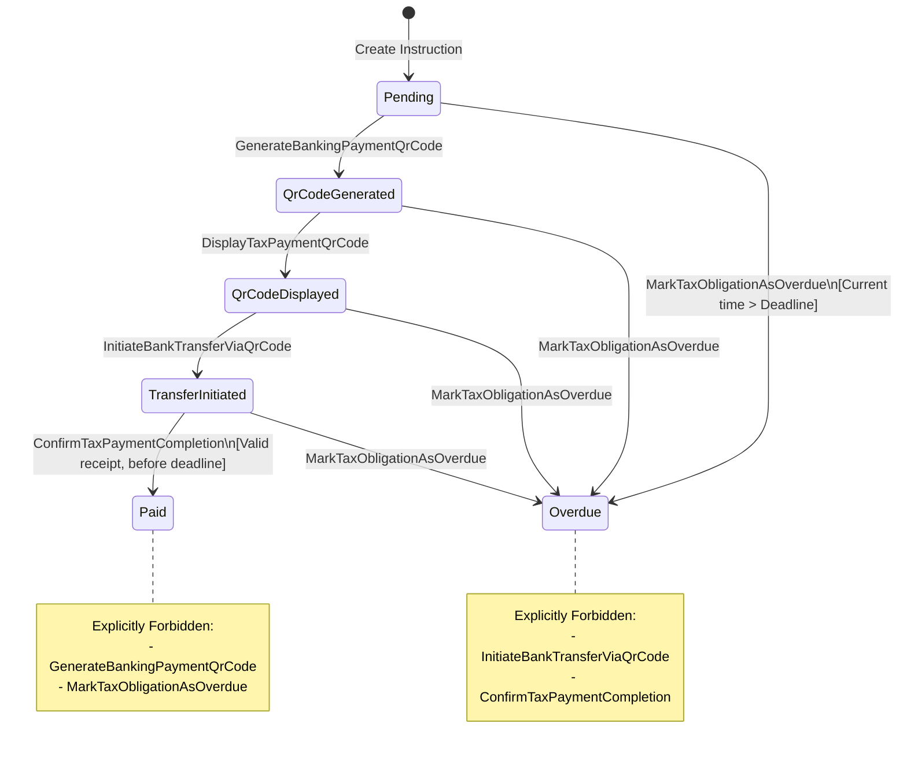

1. Lifecycle State Machine Diagram



2. Catalog of business invariants

| Aggregate | Exact Business Rule | Domain Exception |
| :--- | :--- | :--- |
| 'TaxPaymentInstruction' | Cannot regenerate a banking payment QR code for a tax obligation that is already marked as Paid. | 'PaymentVerificationFailedException' |
| 'TaxPaymentInstruction' | Bank transfer cannot be initiated if the payment deadline has already expired or status is Overdue. | 'TaxPaymentDeadlineExpiredException' |
| 'TaxPaymentInstruction' | Payment confirmation requires a valid ZUS/US receipt reference of at least 5 characters. | 'PaymentVerificationFailedException' |
| 'TaxPaymentInstruction' | Tax obligation amount for QR code generation must be strictly greater than zero. | 'QrCodeGenerationFailedException' |
| 'TaxPaymentInstruction' | Cannot mark a tax obligation as overdue before the payment deadline has actually expired. | 'PaymentVerificationFailedException' |

3. Given-When-Then specification:

Scenario 1: Generating QR Code (Positive)
*   Given: A 'TaxPaymentInstruction' is in the 'Pending' state with a valid obligation amount >0 in pln and a valid 26-digit microaccount.
*   When: The client triggers the 'GenerateBankingPaymentQrCode' command.
*   Then: The aggregate successfully transitions to the 'QrCodeGenerated' state, and the 'EncodedQrCode' Value Object is created and attached to the instruction.

Scenario 2: Confirming Tax Payment (Positive)
*   Given: A 'TaxPaymentInstruction' is in the 'TransferInitiated' state, and the current time is before the 'PaymentDeadline'.
*   When: The 'ConfirmTaxPaymentCompletion' command is invoked with a valid receipt reference for example "RECEIPT-ZUS-2026-9981".
*   Then: The aggregate successfully transitions to the 'Paid' state, sets the 'ConfirmedAt' date, and marks the latest 'BankTransferAttempt' as confirmed.

Scenario 3: Attempting to Regenerate QR Code for a Paid Obligation (Negative)
*   Given: A 'TaxPaymentInstruction' has already been completed and is in the 'Paid' state.
*   When: The 'GenerateBankingPaymentQrCode' command is invoked.
*   Then: The aggregate rejects the operation and throws a 'PaymentVerificationFailedException', leaving the state unchanged.

Scenario 4: Initiating Bank Transfer After Deadline (Negative)
*   Given: A 'TaxPaymentInstruction' is in the 'QrCodeDisplayed' state, but the current time has surpassed the 'PaymentDeadline'.
*   When: The 'InitiateBankTransferViaQrCode' command is invoked.
*   Then: The aggregate rejects the operation and throws a 'TaxPaymentDeadlineExpiredException', blocking the transfer attempt.

4. Choosing a design pattern in the domain

4. Choosing a Design Pattern in the Domain

Pattern: Factory Method (Creational Pattern)
Location: 'TaxPaymentInstruction' creation (and 'EncodedBankingQrCode' initialization).

Description:
Now, the aggregate relies on a public contructor. To block incomplete instances and be sure that object always starts in 'Pending' lifecycle state, we use Factory Method to replace the public contructor. This allows complex validation before the object exists in memory.

C# Interface Contract:
```csharp
public sealed class TaxPaymentInstruction
{
    //Private constructor
    private TaxPaymentInstruction() { } 

    //Factory method declaring the beggining of lifecycle
    public static TaxPaymentInstruction CreatePending(
        ClientId clientId,
        MonthlyTaxSettlementId settlementId,
        TaxAmount obligationAmount,
        MicroAccountNumber microAccountNumber,
        taxAuthorityCode taxAuthorityCode,
        DateTimeOffset paymentDeadline)
    {
        //business rules before object creation
        if (obligationAmount.Value <= 0)
            throw new InvalidTaxAmountException(obligationAmount);

        return new TaxPaymentInstruction
        {
            Id = TaxPaymentInstructionId.New(),
            ClientId = clientId,
            MonthlyTaxSettlementId = settlementId,
            ObligationAmount = obligationAmount,
            MicroAccountNumber = microAccountNumber,
            TaxAuthorityCode = taxAuthorityCode,
            PaymentDeadline = paymentDeadline,
            Status = TaxPaymentStatus.Pending //initial state
        };
    }
}
```